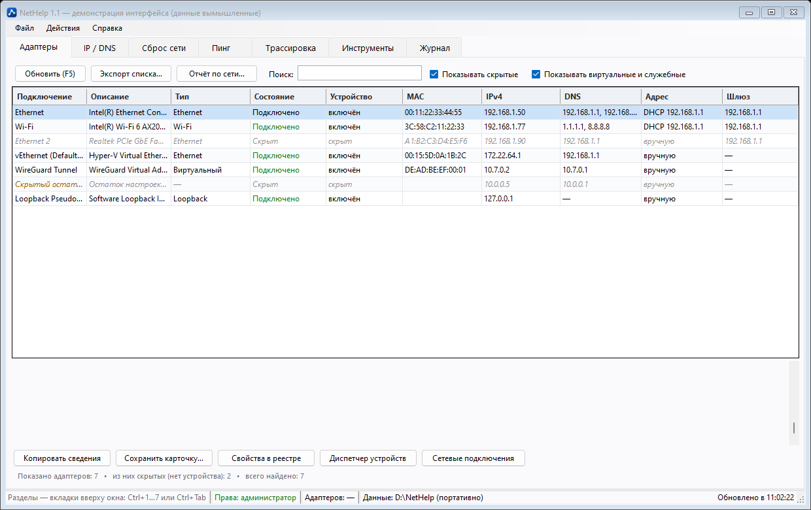
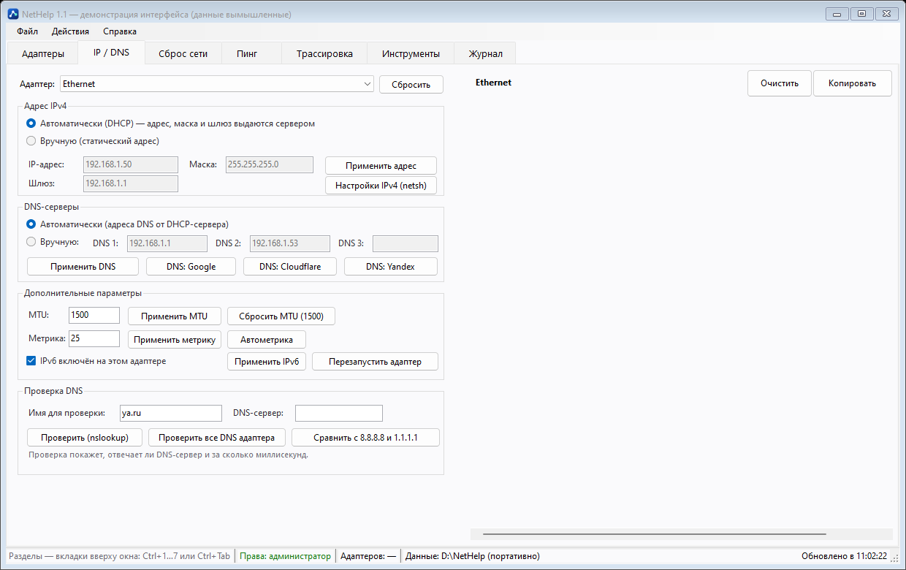
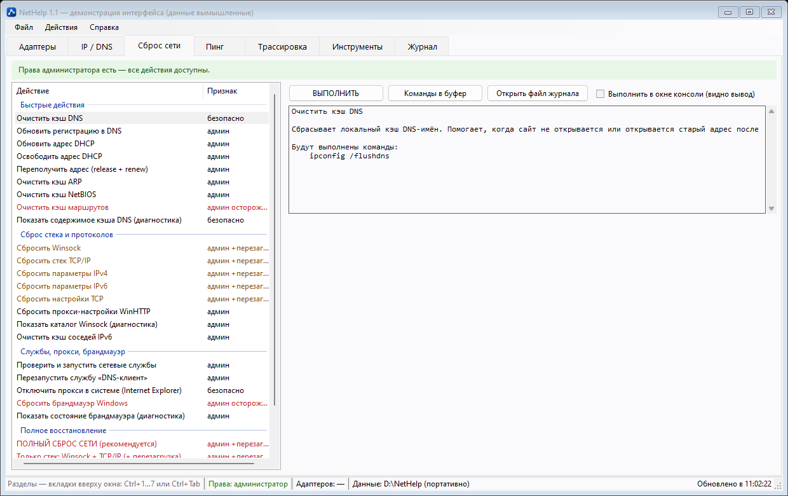
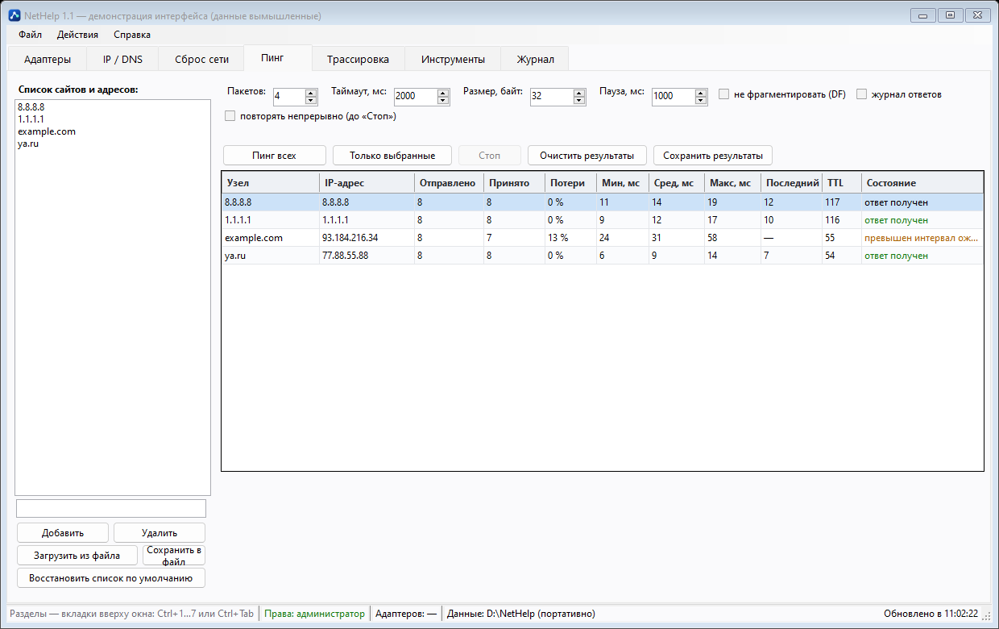
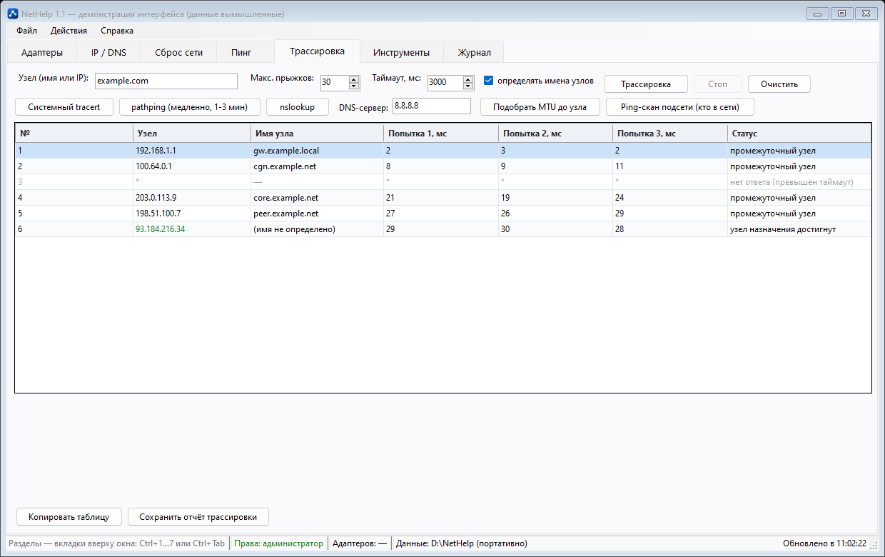
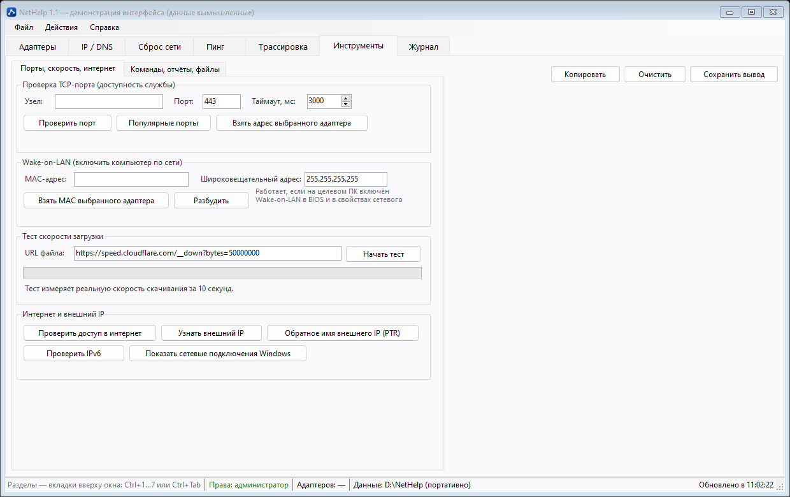
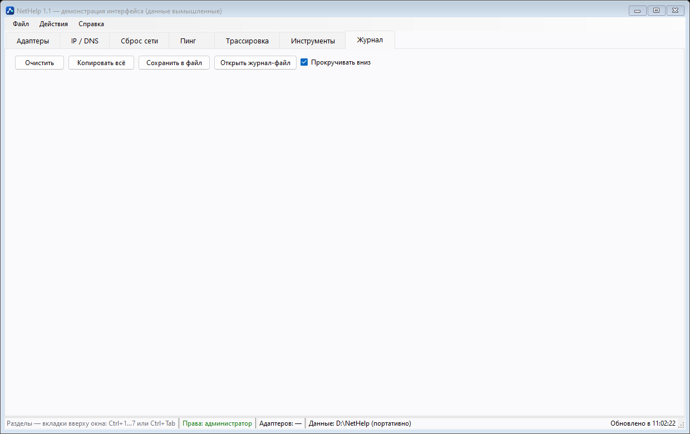

# NetHelp 1.1 — работа с сетевыми картами, сброс сети, диагностика

Один EXE, без установки. Windows 7 SP1 / 8 / 10 / 11 (.NET Framework 4.5 или новее — в Windows 8/10/11 уже встроен).
Работает с флешки: настройки, отчёты и резервные копии реестра пишутся рядом с программой.

**Скачать готовый NetHelp.exe** — [последний релиз](https://github.com/meisterleex-beep/nethelp/releases/latest) (просто запустить, установка не нужна).
Собрать самому из исходников — скрипт `build.cmd` в этой папке (см. раздел 11).

Разделы переключаются **вкладками вверху окна** — мышью, клавишами `Ctrl+1`…`Ctrl+7`
или `Ctrl+Tab` / `Ctrl+Shift+Tab`. При наведении на вкладку показывается подсказка с горячей клавишей.
Меню оставлено только для файлов, действий и справки; пункта «Вид» со списком разделов больше нет.

## Скриншоты

Все снимки сделаны самой программой на **вымышленных данных** — команда
`NetHelp.exe --shots <папка>` наполняет интерфейс демонстрационными адаптерами и адресами,
поэтому ни один реальный компьютер тут не показан.

| | |
|---|---|
| **Адаптеры** — включая скрытые записи реестра | **IP / DNS** — настройки выбранного адаптера |
|  |  |
| **Сброс сети** — кнопки восстановления | **Пинг** — список сайтов и потери пакетов |
|  |  |
| **Трассировка** — своя, tracert, pathping, MTU | **Инструменты** — порты, WoL, скорость, отчёты |
|  |  |
| **Журнал** — все выполненные команды | |
|  | |

---

## 1. Вкладка «Адаптеры» — видеть все сетевые карты, включая скрытые

Данные собираются из четырёх независимых источников, поэтому в списке видно то, что «не видно» в обычных окнах Windows:

| Источник | Что даёт |
|---|---|
| SetupAPI (класс `{4d36e972-…-08002be10318}`) | все сетевые устройства, включая **отсутствующие** (призрачные) — как `set devmgr_show_nonpresent_devices=1` |
| Реестр: `HKLM\SYSTEM\CurrentControlSet\Control\Class\{4d36e972-…}` | все когда-либо установленные адаптеры: драйвер, версия, дата, INF, `NetCfgInstanceId`, тип, заводской MAC |
| Реестр: `…\Services\Tcpip\Parameters\Interfaces\{GUID}` и `Tcpip6` | настройки IP/DNS/DHCP даже у тех адаптеров, которых уже нет в системе |
| WMI `Win32_NetworkAdapter(+Configuration)`, .NET `NetworkInterface` | имя подключения, состояние, скорость, ошибки, живые адреса и DNS |

По каждому адаптеру показывается: имя подключения, описание, тип (Ethernet/Wi-Fi/туннель/виртуальный), состояние,
признак «скрыт», MAC текущий и заводской, IPv4 + маска, шлюз, IPv6, DNS-серверы с источником (DHCP / вручную / из реестра),
DHCP-сервер, MTU, метрика, скорость канала, служба-драйвер, версия и дата драйвера, INF, PnP-идентификатор, GUID,
путь в реестре — и **все значения** реестровых ключей адаптера и TCP/IP (панель сведений снизу).

Возможности вкладки:

* фильтры: поиск по любому полю, «Показывать скрытые», «Показывать виртуальные и служебные»;
* контекстное меню адаптера: получить адрес по DHCP, сбросить DNS, перезапустить / включить / отключить адаптер,
  очистить кэш DNS, показать `netsh … show config`, пинг шлюза, трассировка, проверка DNS-серверов адаптера,
  копирование сведений, экспорт карточки в файл, экспорт ветки реестра в `.reg`;
* **удаление остаточной (скрытой) записи из реестра** — только для отсутствующих устройств, с автоматическим
  бэкапом каждого раздела в `.reg` перед удалением;
* экспорт списка адаптеров в CSV (открывается в Excel);
* полный отчёт по сети в TXT.

---

## 2. Вкладка «IP / DNS» — настройки выбранного адаптера

* **Адрес IPv4**: автоматически (DHCP) или вручную (IP, маска, шлюз) — `netsh interface ipv4 set address`.
* **DNS**: автоматически от DHCP или вручную до трёх серверов; пресеты Google, Cloudflare, Yandex — в один клик.
* **MTU** (576–9000, по умолчанию 1500; для PPPoE 1472, для VPN 1400) и **метрика интерфейса** / автоматическая метрика.
* **IPv6**: включить/выключить на адаптере (частая причина «интернета нет» при работающем IPv4).
* **Перезапуск адаптера** одной кнопкой (выключить → пауза 2,5 с → включить).
* **Проверка DNS**: `nslookup` с замером времени, проверка всех DNS-серверов адаптера, сравнение с 8.8.8.8 и 1.1.1.1.

---

## 3. Вкладка «Сброс сети» — кнопки для «вдруг что-то не работает»

Каждое действие показывает, какие команды будут выполнены, спрашивает подтверждение и пишет всё в журнал.

**Быстрые действия**

| Кнопка | Команда |
|---|---|
| Очистить кэш DNS | `ipconfig /flushdns` |
| Обновить регистрацию в DNS | `ipconfig /registerdns` |
| Обновить адрес DHCP | `ipconfig /renew` |
| Освободить адрес DHCP | `ipconfig /release` |
| Переполучить адрес | `ipconfig /release` + `/flushdns` + `/renew` + `/registerdns` |
| Очистить кэш ARP | `netsh interface ip delete arpcache`, `arp -d *` |
| Очистить кэш NetBIOS | `nbtstat -R`, `nbtstat -RR` |
| Очистить кэш маршрутов | `route -f` |
| Показать кэш DNS (диагностика) | `ipconfig /displaydns` |

**Сброс стека и протоколов**

| Кнопка | Команда |
|---|---|
| Сбросить Winsock | `netsh winsock reset catalog`, `netsh winsock reset` |
| Сбросить стек TCP/IP | `netsh int ip reset` (лог в `%TEMP%\nethelp-ipreset.log`) |
| Сбросить IPv4 | `netsh int ipv4 reset` |
| Сбросить IPv6 | `netsh int ipv6 reset` |
| Сбросить настройки TCP | `netsh int tcp reset` |
| Сбросить прокси WinHTTP | `netsh winhttp reset proxy` |
| Каталог Winsock (диагностика) | `netsh winsock show catalog` |
| Кэш соседей IPv6 | `netsh interface ipv6 delete destinationcache`, `… delete neighbors` |

**Службы, прокси, брандмауэр**

* Проверить и запустить сетевые службы: `Dhcp`, `Dnscache`, `Nsi`, `Netprofm`, `NlaSvc`, `lmhosts`, `BITS`.
* Перезапустить службу «DNS-клиент» (`net stop/start dnscache`).
* Отключить системный прокси Internet Explorer (ветка `Internet Settings`, снимает «нет доступа к сети» после вирусов/VPN).
* Сбросить брандмауэр Windows (`netsh advfirewall reset`) — **удаляет пользовательские правила**.

**Полное восстановление**

* **ПОЛНЫЙ СБРОС СЕТИ (рекомендуется)** — последовательность: кэш DNS и ARP → `release` → Winsock → TCP/IP (IPv4+IPv6) →
  настройки TCP → прокси WinHTTP → NetBIOS → запуск служб → `renew` → `registerdns`; затем предложение перезагрузиться.
* Только стек: Winsock + TCP/IP (+ перезагрузка).
* Перезагрузка компьютера через 15 секунд и отмена запланированной перезагрузки (`shutdown /r`, `shutdown /a`).

---

## 4. Вкладка «Пинг» — список сайтов и адресов

* Список хостов (по умолчанию `8.8.8.8`, `1.1.1.1`, `ya.ru`, `google.com`) сохраняется в `nethelp.cfg`,
  загружается/сохраняется в текстовый файл.
* Параметры: число пакетов, таймаут, размер пакета, «не фрагментировать (DF)», журнал ответов,
  режим «повторять непрерывно» до кнопки «Стоп».
* Таблица: IP, отправлено/принято, потери %, мин/сред/макс/последний, TTL, состояние — с цветовой индикацией.
* Сохранение результатов в отчёт.

---

## 5. Вкладка «Трассировка»

* **Своя трассировка** по TTL (3 попытки на прыжок, определение имён узлов) — таблица + текстовый вывод, без чёрных окон консоли.
* **Системный `tracert`**, **`pathping`** (статистика потерь по узлам), **`nslookup`** с выбором DNS-сервера.
* **Подбор MTU до узла** — поиск «чёрной дыры» пакетами с флагом DF и рекомендация MTU (PPPoE/VPN).
* **Ping-скан подсети** выбранного адаптера: кто ещё есть в сети.

---

## 6. Вкладка «Инструменты»

Раздел разделён на две под-вкладки, чтобы всё помещалось в окно без прокрутки:
**«Порты, скорость, интернет»** и **«Команды, отчёты, файлы»**.

* **Проверка TCP-порта** + проверка популярных портов (21, 22, 23, 25, 53, 80, 110, 135, 139, 143, 443, 445, 993, 995,
  1433, 1521, 3306, 3389, 5432, 5900, 8080, 8443).
* **Wake-on-LAN** (MAC можно брать с выбранного адаптера автоматически).
* **Тест скорости загрузки** (10 секунд, любой URL) с задержкой до первого байта.
* **Интернет и внешний IP**: комплексная проверка (DNS → ICMP → TCP 443 → HTTP), определение внешнего IP,
  обратное имя (PTR), проверка IPv6.
* **Быстрые команды**: `ipconfig /all`, `ipconfig /displaydns`, `netsh interface show interface`,
  `netsh interface ipv4 show config|subinterfaces`, `netsh wlan show interfaces`, `route print -4`, `arp -a`,
  `getmac /v /fo list`, `netsh winhttp show proxy`, `netsh advfirewall show allprofiles`,
  `netstat -ano` **с именами процессов**, `netstat -e`, состояние сетевых служб.
* **Командная строка**: выполнить команду внутри программы, открыть `cmd`, открыть `cmd` от администратора.
* **Файл hosts**: просмотр, правка от имени администратора, открытие папки.
* **Отчёты**: полный отчёт (включая `netstat`) в TXT или в буфер обмена.

## 7. Вкладка «Журнал»

Все выполненные команды и их вывод с отметками времени: копирование, сохранение, прокрутка.
Дополнительно каждая команда пишется в `nethelp-journal.log` рядом с программой.

---

## 8. Портативность и расположение данных

* `nethelp.cfg` — настройки (список пинга, URL теста скорости, фильтры). Пишется рядом с EXE;
  если папка доступна только для чтения (защищённая флешка) — в `%APPDATA%\NetHelp`.
* `reports\` — отчёты (сети, адаптера, пинга, трассировки, журнала).
* `backup\` — резервные копии разделов реестра (`.reg`) перед удалением скрытых записей.
* Программа не устанавливается, службы и драйверы не ставит, автозапуск не прописывает.

## 9. Права администратора

Программа запускается как обычный пользователь: просмотр адаптеров, настройки, диагностика, пинг, трассировка
и отчёты доступны сразу. Для сброса сети, DHCP/DNS и изменения параметров нажмите вверху окна
**«Запустить с правами администратора»** — программа перезапустится с запросом UAC и закроет текущее окно.

## 10. Режимы командной строки

```text
NetHelp.exe --dump  [файл]   список всех адаптеров (включая скрытые) и их параметров
NetHelp.exe --report [файл]  полный отчёт: адаптеры + ipconfig /all, netsh, route, arp, getmac, брандмауэр
NetHelp.exe --uitest [файл]  самопроверка вёрстки интерфейса
NetHelp.exe --uitest <файл> --photos <папка>   то же + снимок каждой вкладки в PNG
NetHelp.exe --shots  <папка>  снимки всех вкладок на демонстрационных данных (для документации)
NetHelp.exe --demo            запуск интерфейса с вымышленными данными — показать, ничего не меняя
```

`--uitest` прогоняет вёрстку каждой вкладки в матрице **3 размера окна × 2 режима прав** (с администратором и без) и проверяет:

* не перекрывает ли меню или баннер о правах полосу вкладок;
* не перекрывают ли элементы друг друга, в том числе пристыкованные панели (Dock);
* хватает ли контейнеру места для пристыкованных панелей;
* **видно ли каждый элемент на самом деле** - по центру элемента выполняется проверка попадания (ловится случай «кнопка есть, но накрыта панелью»).

Так были найдены и исправлены: кнопки запуска в «Пинге» (панель фильтров накрывала панель кнопок), кнопка ping-скана подсети в «Трассировке», флажок «Выполнить в окне консоли» в «Сбросе сети», фильтр «Показывать виртуальные и служебные» в «Адаптерах» и блок «Проверка DNS» в «IP / DNS».

Без указания файла вывод идёт в консоль — удобно для удалённой диагностики и для запроса «пришлите отчёт».
При запуске из PowerShell помните, что оболочка **не ждёт** GUI-приложение: используйте `Start-Process -Wait`
или `cmd /c`, иначе файл отчёта ещё не будет готов к моменту проверки.

## 11. Сборка из исходников

```text
build.cmd
```

Релизы собираются автоматически: GitHub Actions (`.github/workflows/build.yml`) собирает `NetHelp.exe`
при каждом изменении и прикладывает его к релизу по тегу `v*`.

Нужен только .NET Framework 4.x (в Windows 10/11 он есть). Скрипт сам находит `csc.exe`
в `%WINDIR%\Microsoft.NET\Framework64\v4.0.30319` и собирает `NetHelp.exe` из `src\*.cs`.

Состав исходников:

| Файл | Назначение |
|---|---|
| `Program.cs` | точка входа, режимы `--dump` / `--report` / `--uitest` |
| `MainForm.cs` | главное окно, вкладки-разделы (Ctrl+1…7), меню «Файл/Действия/Справка», статусная строка, баннер о правах |
| `Core.cs` | общее состояние, журнал, запуск команд, повышение прав, бэкап реестра |
| `Shell.cs` | запуск консольных утилит со скрытым окном и перехватом вывода (OEM-кодировка) |
| `NetApi.cs` | SetupAPI, чтение реестра, WMI, вспомогательные структуры |
| `Adapters.cs` | модель адаптера, сбор инвентаря, подробная карточка, удаление «призрачных» записей |
| `Cmds.cs` | команды netsh/ipconfig и каталог всех действий по сбросу |
| `Report.cs` | текстовые отчёты (сеть, адаптер, пинг, трассировка) |
| `Settings.cs` | портативные настройки (`nethelp.cfg`) |
| `TabAdapters.cs`, `TabIpDns.cs`, `TabReset.cs`, `TabPing.cs`, `TabTrace.cs`, `TabTools.cs`, `TabJournal.cs` | вкладки интерфейса |
| `Ui.cs`, `UiAudit.cs` | элементы оформления и автопроверка вёрстки |

## 12. Важно и безопасно

* `netsh winsock reset`, `netsh int ip reset`, `netsh int ipv4|ipv6 reset`, `netsh int tcp reset`
  вступают в силу **после перезагрузки** — программа предложит её выполнить.
* `netsh advfirewall reset` удаляет все созданные вручную правила брандмауэра.
* `route -f` очищает таблицу маршрутов: при нестандартной маршрутизации связь может кратко прерваться.
* Удаление скрытых записей выполняется только для **отсутствующих** устройств, каждый раздел реестра
  предварительно сохраняется в `backup\*.reg` — откат делается двойным щелчком по `.reg`.
* Изменение MTU и метрики применяется сразу; активное соединение на пару секунд прерывается.

## 13. Частые вопросы

* **Не вижу Wi-Fi адаптер** — включите галочку «Показывать виртуальные и служебные», при необходимости «Показывать скрытые».
* **Адаптер есть в списке, но написано «нет имени подключения»** — устройство отсутствует или это остаток реестра:
  команды netsh к нему не применить, доступны просмотр карточки, экспорт и удаление записи.
* **Дубликаты Ethernet 2, Ethernet 3** — так Windows переименовывает подключения после переустановки драйвера;
  остатки удаляются кнопкой «Удалить остаточную запись из реестра» в контекстном меню скрытого адаптера.
* **Скрипты/консоль**: если нужно быстро получить данные с чужого ПК — `NetHelp.exe --report D:\report.txt` с флешки.

---

NetHelp 1.1 · лицензия [MIT](LICENSE) · собирается из исходников этой папки скриптом `build.cmd`.
