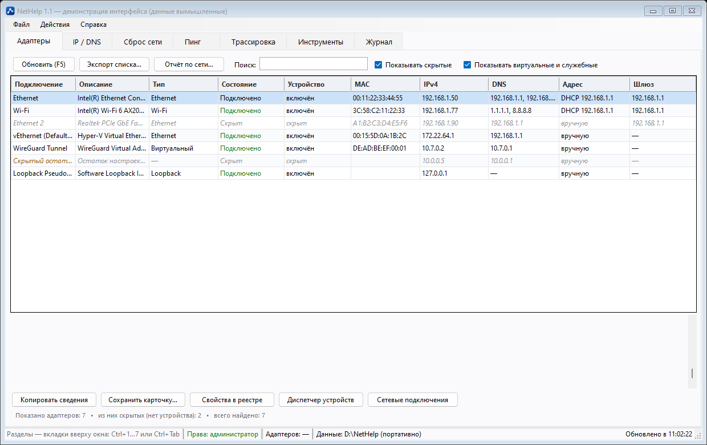
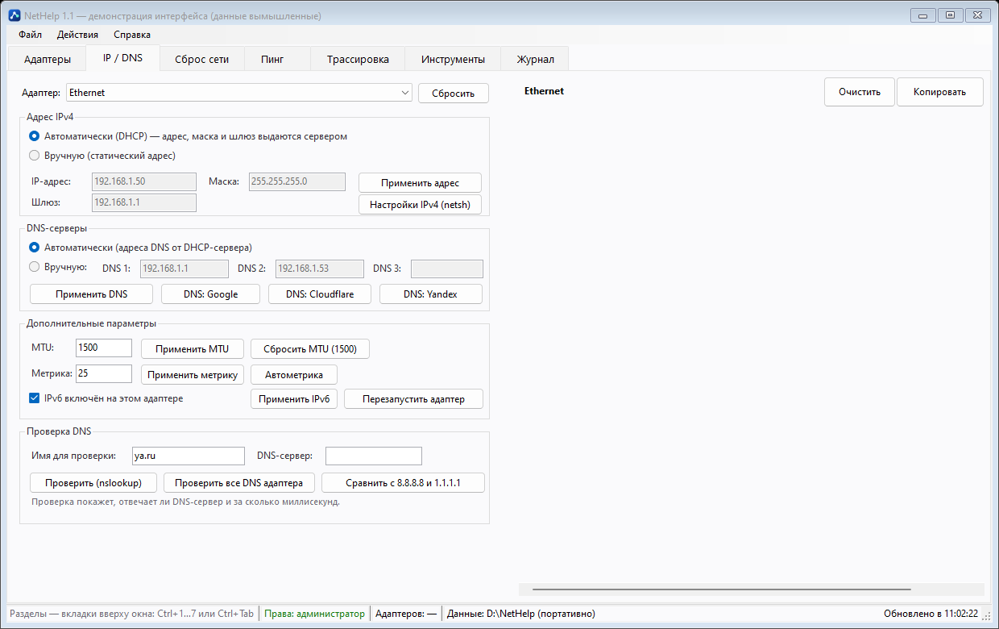
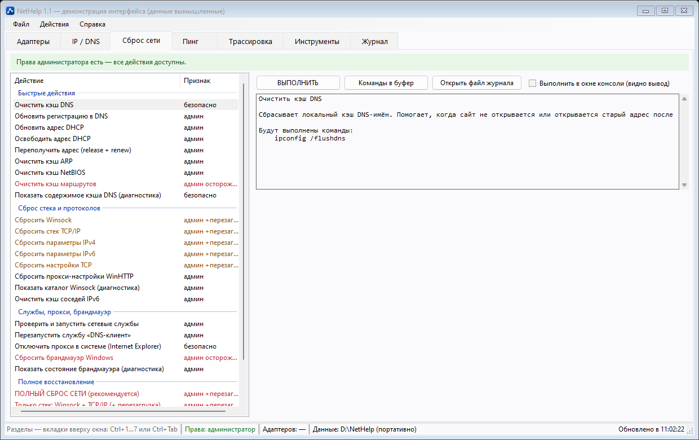
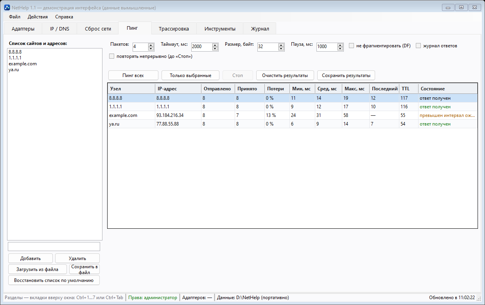
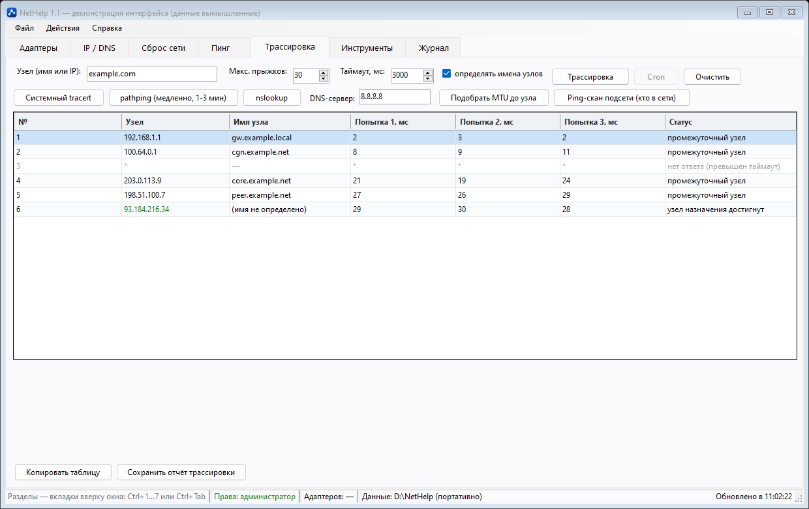
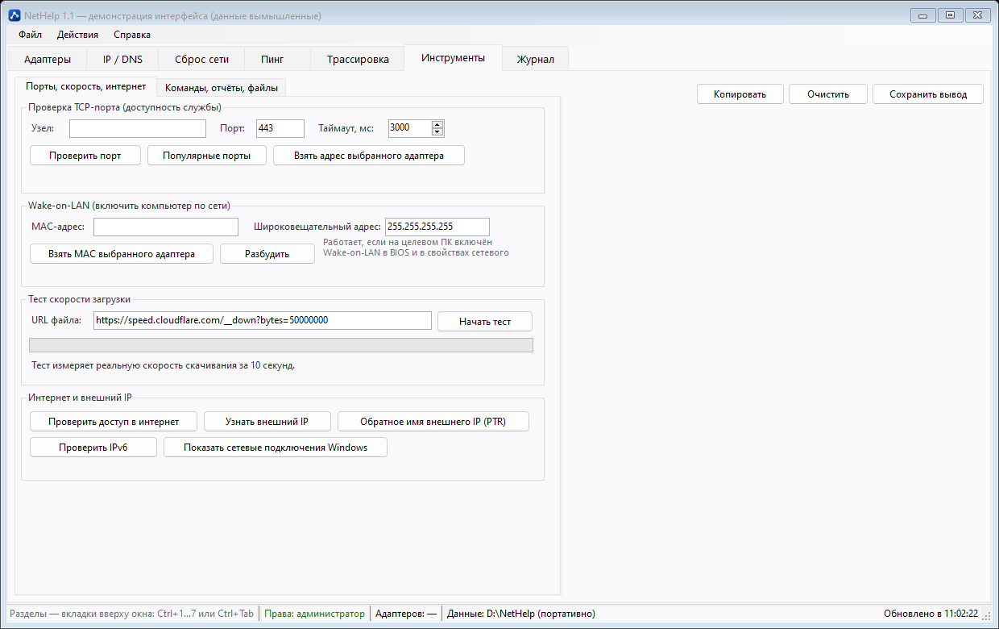
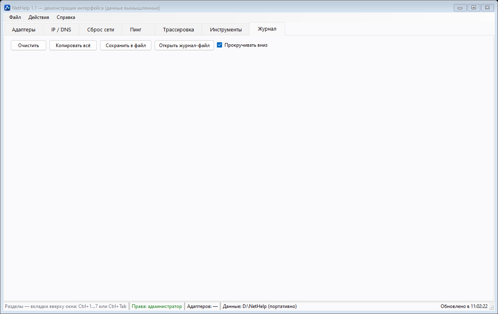

## NetHelp — портативная утилита для работы с сетевыми адаптерами Windows

Один EXE, без установки, работает с флешки.
Windows 7 SP1 / 8 / 10 / 11 (.NET Framework 4.5+ уже встроен в Windows 8/10/11).



### Что умеет

* **Адаптеры** — все сетевые карты, включая **скрытые** (отсутствующие) записи: SetupAPI по классу сетевых устройств + реестр (`Class`, `Tcpip`, `Tcpip6`, `Network`) + WMI + `NetworkInterface`. Подробная карточка: MAC (текущий и заводской), IPv4/IPv6, шлюз, DNS с указанием источника, DHCP, MTU, метрика, драйвер, INF, PnP-ID, GUID и **все значения** его ключей реестра.
* **IP / DNS** — DHCP или статический адрес, DNS до трёх серверов (пресеты Google / Cloudflare / Yandex), MTU, метрика, IPv6, перезапуск адаптера, проверка DNS с замером времени ответа.
* **Сброс сети** — 25 действий кнопками: кэш DNS, `registerdns`, `renew`/`release`, ARP, NetBIOS, кэш маршрутов, Winsock, TCP/IP (IPv4 и IPv6), настройки TCP, прокси WinHTTP и WinINET, сетевые службы, брандмауэр, а также **полный сброс сети одной кнопкой**. Каждое действие показывает свои команды и пишет всё в журнал.
* **Пинг** — список сайтов и адресов, потери пакетов, мин/сред/макс, TTL, непрерывный режим.
* **Трассировка** — своя по TTL, системный `tracert`, `pathping`, `nslookup`, подбор MTU («чёрная дыра»), ping-скан подсети.
* **Инструменты** — проверка TCP-портов (в том числе популярных), Wake-on-LAN, тест скорости, проверка доступа в интернет, внешний IP и PTR, быстрые команды (`ipconfig`, `netsh`, `netstat -ano` с именами процессов, `arp`, `route`, `getmac`), файл hosts, отчёты.
* **Журнал** — все выполненные команды и их вывод.

### Скриншоты

| | |
|---|---|
|  |  |
|  |  |
|  |  |
|  | |

### Как запустить

1. Скачайте `NetHelp.exe` из этого релиза.
2. Запустите — установка не нужна, настройки и отчёты пишутся рядом с файлом (с флешки тоже работает).
3. Права администратора программа запрашивает сама: просмотр, диагностика, пинг и отчёты доступны и без них.

### Сборка из исходников

```
build.cmd
```

Используется компилятор C# из состава .NET Framework — доустанавливать ничего не нужно.
Релизы собираются автоматически: GitHub Actions (`.github/workflows/build.yml`) собирает `NetHelp.exe`
при каждом изменении и прикладывает его к релизу по тегу `v*`.

### Режимы командной строки

```
NetHelp.exe --dump   [файл]   список адаптеров, включая скрытые
NetHelp.exe --report [файл]   полный отчёт для диагностики
NetHelp.exe --uitest [файл]   самопроверка вёрстки интерфейса
NetHelp.exe --shots  <папка>  снимки всех вкладок на демонстрационных данных
NetHelp.exe --demo            запуск интерфейса с вымышленными данными
```

### Лицензия

MIT — см. [LICENSE](https://github.com/meisterleex-beep/nethelp/blob/main/LICENSE).
